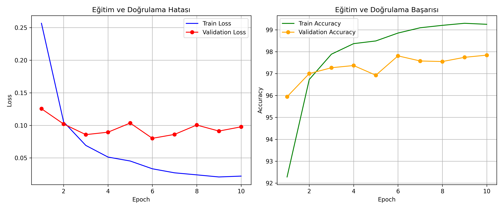
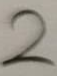
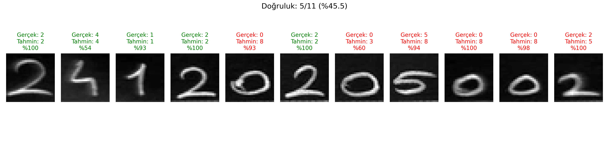

# MNIST Veri Seti ile MLP Tabanlı El Yazısı Rakam Tanıma

## 1. Proje Özeti ve Amaç
Bu çalışmanın amacı, derin öğrenme yöntemlerinden Çok Katmanlı Algılayıcı (Multi-Layer Perceptron - MLP) mimarisi kullanılarak MNIST el yazısı rakam veri seti üzerinde bir sınıflandırma modeli eğitmek, modelin eğitim/doğrulama/test performansını ölçmek ve elde edilen modelin gerçek dünya el yazısı verileri üzerindeki genelleme (generalization) başarısını değerlendirmektir.

Çalışma kapsamında Convolutional Neural Network (CNN) mimarileri kullanılmamış; temel MLP katmanları, ReLU aktivasyon fonksiyonu, Cross Entropy kayıp fonksiyonu ve Adam optimizasyon algoritması kullanılarak model sıfırdan eğitilmiştir. Eğitim sonrasında, öğrenci okul numarası el yazısıyla yazılarak dijital ortama aktarılmış, MNIST formatına ön işleme adımlarıyla dönüştürülmüş ve modelin bu gerçek veriler üzerindeki performansı analiz edilmiştir.

---

## 2. Model Mimarisi ve Hiperparametreler

### Model Yapısı (MLP)
Model, 28x28 boyutundaki görüntüleri tek boyutlu 784 elemanlı vektöre dönüştürerek işleyen, en az 2 gizli katman (hidden layer) içeren tam bağlantılı (fully connected) bir mimariye sahiptir.

* **Girdi Katmanı (Input):** 784 nöron ($28 \times 28$ piksel düzleştirilmiş vektör)
* **1. Gizli Katman (Hidden Layer 1):** 256 nöron + ReLU aktivasyon fonksiyonu
* **2. Gizli Katman (Hidden Layer 2):** 128 nöron + ReLU aktivasyon fonksiyonu
* **Çıkış Katmanı (Output Layer):** 10 nöron (0-9 arasındaki sınıflar için logit çıktıları)

### Hiperparametreler
* **Kayıp Fonksiyonu (Loss Function):** CrossEntropyLoss
* **Optimizasyon Algoritması (Optimizer):** Adam
* **Öğrenme Oranı (Learning Rate):** 0.001
* **Paket Boyutu (Batch Size):** 64
* **Dönem Sayısı (Epoch):** 10
* **Rastgelelik Tohumu (Random Seed):** 60
* **Kullanılan Donanım:** CPU

---

## 3. Veri Seti ve Bölütleme

MNIST veri kümesi toplam 70.000 adet 28x28 boyutunda gri seviyeli el yazısı rakam görüntüsünden oluşmaktadır. Veri kümesi ödev gereksinimlerine uygun olarak üç bağımsız parçaya ayrılmıştır:

* **Eğitim Kümesi (Train Set):** 48.000 örnek (%80) - Modelin ağırlıklarının güncellenmesi için kullanılmıştır.
* **Doğrulama Kümesi (Validation Set):** 12.000 örnek (%20) - Eğitim süresince aşırı öğrenmenin (overfitting) takip edilmesi amacıyla kullanılmıştır.
* **Test Kümesi (Test Set):** 10.000 örnek - Model geliştirme ve eğitim sürecinde kesinlikle kullanılmamış, sadece nihai performansı ölçmek için kullanılmıştır.

### Ön İşleme (Preprocessing)
Tüm görüntüler `ToTensor()` ile [0.0, 1.0] aralığına çekilmiş, ardından MNIST küresel ortalaması (0.1307) ve standart sapması (0.3081) kullanılarak normalize edilmiştir.

---

## 4. Eğitim ve Test Deney Sonuçları

Model 10 epoch boyunca eğitilmiş olup elde edilen metrikler aşağıdaki tabloda özetlenmiştir:

| Epoch | Training Loss | Training Accuracy (%) | Validation Loss | Validation Accuracy (%) |
| :---: | :---: | :---: | :---: | :---: |
| 1 | 0.2566 | 92.28 | 0.1255 | 95.94 |
| 2 | 0.1054 | 96.73 | 0.1021 | 97.07 |
| 3 | 0.0692 | 97.89 | 0.0858 | 97.27 |
| 4 | 0.0513 | 98.37 | 0.0895 | 97.37 |
| 5 | 0.0453 | 98.49 | 0.1035 | 96.93 |
| 6 | 0.0333 | 98.85 | 0.0801 | 97.81 |
| 7 | 0.0272 | 99.09 | 0.0861 | 97.58 |
| 8 | 0.0240 | 99.20 | 0.1005 | 97.55 |
| 9 | 0.0208 | 99.30 | 0.0912 | 97.74 |
| 10 | 0.0221 | 99.25 | 0.0977 | 97.84 |

### Nihai Performans Özeti
* **Toplam Eğitim Süresi:** ~59.50 saniye
* **Eğitim Başarısı (Train Accuracy):** %99.25
* **Doğrulama Başarısı (Validation Accuracy):** %97.84
* **Nihai Test Başarısı (Test Accuracy):** %97.74

### Eğitim Süreci Grafikleri
Eğitim ve doğrulama süreçlerine ait kayıp (loss) ve doğruluk (accuracy) eğrileri aşağıda sunulmuştur:


*Şekil 1: 10 epoch boyunca eğitim ve doğrulama kaybı (loss) ile doğruluk (accuracy) değişim grafikleri.*

Grafik incelendiğinde eğitim kaybının istikrarlı bir şekilde düştüğü, doğrulama kaybının ise 0.08 - 0.10 bandında dengelendiği görülmektedir. Model aşırı ezberlemeye (overfitting) girmeden yüksek bir doğruluk oranına ulaşmıştır.

---

## 5. Kendi El Yazısı Verileri ile Test (Öğrenci Numarası)

Öğrenci numarası (**24120205002**) beyaz kağıt üzerine tükenmez kalem ile el yazısıyla yazılmış, fotoğraflanarak kırpılmış ve sisteme aktarılmıştır.

### Ham El Yazısı Görüntüleri (`rakamlar/`)
Öğrenci numarasına ait `rakamlar/` klasöründeki ham el yazısı fotoğrafları aşağıda 5'li ızgara (5x2 düzeninde) şeklinde sunulmuştur:

| 1. Hane (2) | 2. Hane (4) | 3. Hane (1) | 4. Hane (2) | 5. Hane (0) |
| :---: | :---: | :---: | :---: | :---: |
|  |  |  |  |  |
| **6. Hane (2)** | **7. Hane (0)** | **8. Hane (5)** | **9. Hane (0)** | **10. Hane (0)** |
|  |  |  |  |  |
| **11. Hane (2)** | | | | |
|  | | | | |

### Görüntü İşleme Adımları
Gerçek dünya fotoğraflarını MNIST formatına uyumlu hale getirmek için `process_image` fonksiyonunda şu adımlar uygulanmıştır:
1. **Gri Seviyeye Dönüştürme:** Renkli görüntüler PIL kütüphanesi kullanılarak 8-bit tek kanallı gri seviyeye (`'L'`) çevrilmiştir.
2. **Renklerin Tersine Çevrilmesi (Inversion):** Kağıt beyaz (255), mürekkep siyah (0) olduğu için değerler $255 - x$ formülüyle ters çevrilmiştir. Böylece MNIST standartlarında olduğu gibi arka plan siyah (0), rakam çizgileri açık renk (255) yapılmıştır.
3. **Arka Plan Temizleme (Thresholding):** Kağıt üzerindeki ortam ışığı gölgeleri eşikleme yöntemiyle sıfırlanmıştır.
4. **Boyutlandırma:** Görüntüler LANCZOS interpolasyonu ile 28x28 piksel boyutuna getirilmiştir.
5. **Normalizasyon:** Görüntüler [0.0, 1.0] aralığına çekilip MNIST ortalama ve sapma değerleriyle normalize edilmiştir.

### Tahmin Sonuçları Tablosu

| Hane No | Gerçek Rakam | Model Tahmini | Güven Skoru (%) | Sonuç |
| :---: | :---: | :---: | :---: | :---: |
| 1 | 2 | 2 | 100.0 | Doğru |
| 2 | 4 | 4 | 53.6 | Doğru |
| 3 | 1 | 1 | 93.0 | Doğru |
| 4 | 2 | 2 | 99.9 | Doğru |
| 5 | 0 | 8 | 93.1 | Yanlış |
| 6 | 2 | 2 | 100.0 | Doğru |
| 7 | 0 | 3 | 59.9 | Yanlış |
| 8 | 5 | 8 | 93.6 | Yanlış |
| 9 | 0 | 8 | 99.7 | Yanlış |
| 10 | 0 | 5 | 100.0 | Yanlış |
| 11 | 2 | 8 | 98.3 | Yanlış |

* **Öğrenci Numarası Doğruluk Oranı:** 5 / 11 (%45.45)

### Tahminlerin Görselleştirilmesi
Aşağıdaki görselde işlenmiş 28x28 piksellik el yazısı rakamları ve modelin her bir rakam için ürettiği tahminler gösterilmektedir:


*Şekil 2: Öğrenci numarasına ait el yazısı rakamları, model tahminleri ve güven skorları.*

---

## 6. Deney Sonuçlarının Genel Değerlendirmesi ve Dağılım Kayması (Distribution Shift)

Model, MNIST test veri kümesinde **%97.74** gibi yüksek bir başarı elde etmesine karşın, kendi el yazımızla oluşturulan gerçek dünya görüntülerinde **%45.45** doğruluk seviyesinde kalmıştır. Bu farkın nedenleri derin öğrenme teorisi çerçevesinde şu şekilde açıklanabilir:

1. **Dağılım Kayması (Distribution Shift):**
   MNIST veri kümesindeki rakamlar belirli standartlarda kalın fırçalarla yazılmış, kütle merkezleri (center of mass) hesaplanarak 28x28 alanın tam merkezine hizalanmıştır. Gerçek dünyada tükenmez kalemle yazılan çizgiler MNIST'e kıyasla oldukça incedir. Çizgi kalınlığı ve mürekkep yoğunluğundaki bu farklılık, eğitim dağılımı ile test dağılımı arasında uyuşmazlığa yol açmıştır.

2. **MLP Mimarisinin Uzamsal Öteleme Hassasiyeti (Translation Invariance Eksikliği):**
   Ödev kuralı gereği CNN yerine MLP (tam bağlantılı ağ) kullanılmıştır. MLP modelleri 2 boyutlu görüntü matrisini tek boyutlu 784 elemanlı vektöre düzleştirir (flatten). Bu durum, pikseller arasındaki komşuluk ve geometrik konumsal ilişkilerin kaybolmasına yol açar. Bir rakam merkeze göre birkaç piksel sağa, sola veya yukarı kaydığında, MLP nöronları tamamen farklı piksellerle işlem yapar ve rakamı tanıyamaz. CNN modellerindeki konvolüsyon ve havuzlama (pooling) katmanları bu tür ötelemelere karşı dayanıklıyken, MLP bu kaymalara karşı son derece hassastır.

3. **Karakter Biçimsel Benzerlikleri ve Yanılgılar:**
   İnce çizgilerle yazılan `0` rakamlarının eğimleri ve boşlukları, model tarafından `8` veya `3` olarak sınıflandırılmıştır. Benzer şekilde `5` rakamı üst ve alt kıvrımlarının kapalılık algısı nedeniyle `8` sınıfına atanmıştır.

4. **Yüksek Güvenli Hatalar (Overconfidence):**
   Model bazı yanlış tahminlerinde dahi %90'ın üzerinde güven skoru üretmiştir. Bu durum, Softmax tabanlı sınıflandırma modellerinin eğitim dağılımı dışındaki (Out-of-Distribution) verilerle karşılaştıklarında aşırı özgüvenli hatalı tahminler üretebileceğini göstermektedir.

---

## 7. Projenin Çalıştırılması

Gereksinimler:
* Python 3.10+
* PyTorch & Torchvision
* NumPy, Matplotlib, Pillow

Projeyi çalıştırmak için:
```bash
python main.py
```
Komut çalıştırıldığında veri kümesi indirilecek, model eğitilecek, eğitim grafikleri çizilecek ve `rakamlar/` klasöründeki öğrenci numarası görüntüleri test edilerek sonuçlar ekrana ve diske kaydedilecektir.
